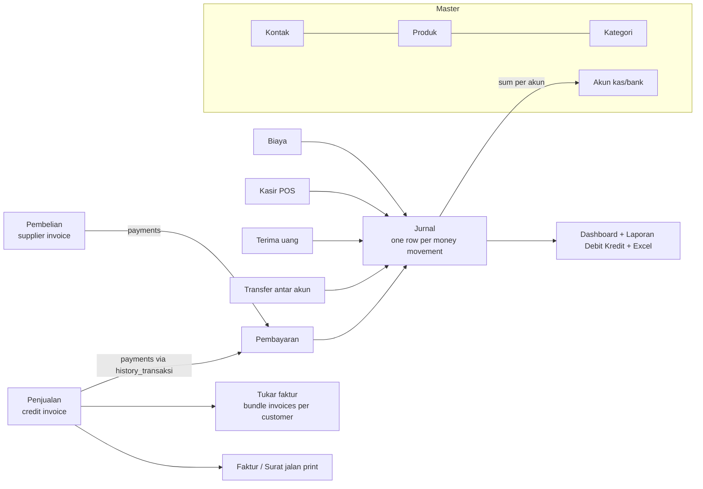

# E-Jurnal UMKM: discovery of the existing system

Explored on 2026-11-12 at `https://acitech.web.id/e-jurnal/` while logged in as an `admin` user.
The exploration was read-only. It used GET page loads, DataTables list endpoints, and headless screenshots.
Nothing was created, edited, or deleted.

Screenshots are in `docs/discovery/screens/`. That folder is gitignored because it shows real customer names, amounts, and a bank account number.

## 1. What the product is

The product is a bookkeeping and sales app for one Indonesian paint shop, "Toko Cat Sumber Karya" in Tangerang.
It is branded "Aplikasi E-Jurnal UMKM" and uses the "Bangga Buatan Indonesia" logo.
It does four jobs:

1. Invoice B2B customers on credit terms ("Penjualan"), and track receivables and payments.
2. Record supplier purchases on credit terms ("Pembelian"), and track payables.
3. Run a walk-in point of sale ("Kasir").
4. Show cash and bank balances and a cash-movement log ("Buku Besar").

The product is a single-tenant install. There is no concept of a company or an organization in the data.

### Live data volume (recordsTotal from the list endpoints)

| Entity | Rows |
|---|---|
| Users | 3 (roles: admin, user, kasir) |
| Kontak (customers, suppliers, employees) | 428 |
| Kategori produk | 5 |
| Produk | 4,174 |
| Akun kas/bank | 6 |
| Penjualan (sales invoices) | 10,705 |
| Pembelian (purchase invoices) | 11,081 |
| Biaya (expenses) | 1,311 |
| Tukar faktur (invoice bundles) | 659 |
| Kasir (POS receipts) | 50,064 |
| Jurnal rows | 95,436 |

The system is in daily production use. A rework needs a data migration path, not a greenfield start.

## 2. Tech stack (observed)

| Layer | What it is | Evidence |
|---|---|---|
| Server | PHP 8.1 or newer, CodeIgniter 3 | `ci_session` cookie. Error backtrace path `dev/application/controllers/transaksi/Biaya.php`. The `number_format(null)` deprecation exists only from PHP 8.1. |
| Hosting | cPanel shared hosting, LiteSpeed | `server: LiteSpeed`. Path `/home/acitechw/public_html/e-jurnal/`. |
| Views | Server-rendered PHP templates in `templates/` | Error backtrace `templates/transaksi/biaya.php`. |
| UI kit | Metronic 8 (Keenthemes) admin theme on Bootstrap 5 | Footer "2021© Keenthemes About Support Purchase". The Metronic demo logo shows on mobile. |
| Frontend JS | jQuery 3.6.4, DataTables (server-side mode), Chart.js, SweetAlert2 (CDN, unpinned `@11`), jquery.priceformat, jquery-repeater. FullCalendar CSS loads but is unused. | `<script>` tags |
| App JS | `custom-script.js` (5,592 lines), `custom-script-kasir.js` (713), `custom-script-dashboard.js` (93). All three load on every page. | `assets/js/` |
| IDs | Short hashid-style public IDs, such as `lPXj` and `RE` | URLs and `<option value>` |
| Auth | Session cookie, 2 h `Max-Age`, `HttpOnly`, `Secure`, `SameSite=Lax` | Response headers from `login/cek_login` |
| Database | Not visible. Probably MySQL (the CodeIgniter 3 default on cPanel). | Guess |

## 3. Module map and routes

The base is `https://acitech.web.id/e-jurnal/`. Page routes are GET requests. Data and actions are AJAX POST requests that return JSON.

| Menu | Page route | List endpoint (DataTables POST) | Write endpoints seen in JS |
|---|---|---|---|
| Login | `login` | | `login/cek_login`, `login/logout` |
| Dashboard | `/` | `dashboard/get_grafik` | |
| Users | `master/users` | `get_ajax_user` | `{path}/{form action}`, `/edit`, `/delete` |
| Customer & Supplier | `master/kontak` | `get_ajax_kontak` | same pattern |
| Kategori Produk | `master/kategori` | `get_ajax_kategori` | same pattern |
| Master Produk | `master/produk` | `get_ajax_produk` | same pattern |
| Akun Rekening | `book/kasbank`, `book/kasbank/transfer_uang/{id}`, `book/kasbank/terima_uang/{id}` | `get_ajax_akun`, `get_ajax_transfer_akun`, `get_ajax_terima_uang` | `book/kasbank/add_transfer`, `book/kasbank/add_terima_uang`, `/delete` |
| Laporan Debit Kredit | `transaksi/jurnal` | `get_ajax_jurnal` (filters `start_date`, `end_date`, `akun`) | `transaksi/jurnal/export_excell?start_date&end_date` (GET) |
| Penjualan | `transaksi/penjualan`, `tambah_penjualan`, `detail/{id}`, `edit/{id}`, `history_transaksi/{id}`, `surat_faktur/{id}`, `surat_jalan/{id}` | `get_ajax_penjualan` | `submit_penjualan`, `update_penjualan`, `add_transaksi` (payment), `/delete` |
| Pembelian | `transaksi/pembelian`, `tambah_pembelian`, `detail/{id}` | `get_ajax_pembelian` | `submit_pembelian`, `update_pembelian`, `add_transaksi`, `/delete` |
| Biaya | `transaksi/biaya` | `get_ajax_biaya` | form action, `/delete` |
| Tukar Faktur | `transaksi/tukar_faktur`, `buat_tukar_faktur`, `detail/{id}`, `edit_data/{id}` | `get_ajax_tukar_faktur` | `submit_tukar_faktur`, `update_tukar_faktur`, `/delete` |
| Hutang per kontak | (link from Kontak list) | `transaksi/Hutang/get_ajax_customer/`, `transaksi/Hutang/get_ajax_suplier/` | |
| Kasir | `kasir/form` | `kasir/form/get_ajax_produk_kasir` | `kasir/form/submit_kasir`, `kasir/form/delete_list` |
| List Kasir | `kasir/report_kasir` | `get_ajax_report_kasir` | `/delete`, print receipt |

The list endpoints return rows as positional arrays with pre-rendered HTML in the cells (formatted `Rp.` strings and action buttons). They do not return typed JSON. Example: `["1.","<customer name>","SO#20261112-499","12/11/2026","Rp. 3.460.000,00",…,"<a href=…>Detail</a>…"]`.

## 4. Data model (inferred from form field names)

```
users        (username, password, email, fullname, bagian: admin|user|kasir)
kontak       (kode_kontak CUST###/SUPP###, nama_kontak, tipe_kontak: customer|suppliyer|karyawan|dll,
              email, no_hp, no_identitas, alamat_kontak, avatar)
kategori     (nama_kategori, desc_kategori)
produk       (kode_produk, nama_produk, kategori_produk→kategori, varian, desc_produk,
              harga_jual, harga_beli, stock, unit, tipe_produk: single|bundle, gambar)
kas_bank     (kode_akun BANK###, nama_akun, jenis_akun: kas|bank, total_debit, total_kredit, total_saldo)

penjualan    (kode_penjualan SO#YYYYMMDD-n, customer→kontak, metode_pembayaran/jenis_pembayaran (tempo),
              tanggal_transaksi, tgl_jatuh_tempo, no_surat_jalan,
              subtotal, jenis_diskon %|rp, persentase_diskon, jumlah_diskon,
              to_payment→kas_bank, total_tagihan, total_dibayar, sisa_tagihan, status_transaksi PAID|UNPAID)
penjualan_detail (produk, note, qty, harga_satuan, jenis_diskon, persentase_diskon, total_diskon, subtotal, total_harga)
pembayaran   (id_master→penjualan|pembelian, tujuan_pembayaran→kas_bank, metode cash|transfer,
              tgl_pembayaran, total_tagihan, total_pembayaran, sisa_tagihan, bukti (image))

pembelian    (no_faktur (supplier's number), suppliyer→kontak, metode/jenis_pembayaran (KREDIT, "60 Hari"),
              tanggal_transaksi, tgl_jatuh_tempo, subtotal, persentase_ppn, jumlah_ppn, diskon…,
              sumber dana→kas_bank, total_tagihan, total_dibayar, sisa_tagihan, status)
pembelian_detail (same shape as penjualan_detail)

biaya        (no_invoice, nama_biaya, metode_pembayaran, sumber_dana→kas_bank, tgl_pembayaran,
              subtotal, diskon…, total_tagihan, total_dibayar, sisa_tagihan, bukti)
tukar_faktur (kode TF#YYYY-MM-DD-n, customer, [no_faktur→penjualan, total_tagihan]*, jumlah_tagihan)
kasir        (kode_penjualan C YYMMDD-n, tgl_transaksi, [produk, harga, qty, diskon, note]*,
              subtotal, jenis_diskon, jumlah_diskon, to_payment→kas_bank, total_tagihan, total_dibayar, kembalian)
transfer     (from_payment→kas_bank, akun_tujuan→kas_bank, tanggal, total_transfer, keterangan, bukti)
terima_uang  (id_kas_bank, tanggal, total_terima, keterangan, bukti)
jurnal       (no_faktur, jenis: penjualan|pembelian|kasir|biaya|terima uang|transfer…, akun→kas_bank,
              tgl_transaksi, debit, kredit)
```

Amounts travel as integer rupiah. The client strips `.` thousand separators and calls `parseInt`.

## 5. Data flow



1. **Sales on credit.** In `tambah_penjualan` the user picks a customer, a payment method (cash or tempo), a date, product rows (repeater), a discount, and a "Tujuan Pembayaran" account. The browser computes subtotal, total, paid, and remaining amounts and posts them to `submit_penjualan`. Later payments are added on `history_transaksi/{id}`. That modal posts `total_pembayaran`, `sisa_tagihan`, `sudah_bayar`, and `status_transaksi`, all computed in the browser, to `penjualan/add_transaksi` with an optional proof image.
2. **Purchases.** This flow mirrors sales and adds PPN (VAT). The supplier invoice number is typed in by hand. The terms are "KREDIT, 60 Hari", which sets `tgl_jatuh_tempo`.
3. **POS (Kasir).** The cashier picks products from a DataTable, adds them to a cart, picks a discount, a payment account, and the amount tendered, and the page computes the change. The receipt number is `C{YYMMDD}-{n}`. The page posts to `submit_kasir`, and a receipt print follows.
4. **Tukar faktur.** This bundles several unpaid sales invoices of one customer into one billing document (TF#…) for invoice exchange. It is a common Indonesian B2B collection practice.
5. **Jurnal.** Every money movement writes one row against one cash or bank account. Credit invoices write a row with amount 0 at creation. Payments write the real amount.
6. **Akun balances.** `total_debit`, `total_kredit`, and `total_saldo` are stored on the account row. They are not derived on read (the form field names are the evidence).
7. **Dashboard.** It shows 12-month totals per stream (penjualan, pembelian, biaya, kasir) from `dashboard/get_grafik`. That endpoint returns monthly arrays as strings.

## 6. Findings that matter for the rework

### Accounting correctness

- **It is a cash book, not a double-entry journal.** Each jurnal row touches one account, and it can only be a cash or bank account. The system has no chart of accounts: no revenue, COGS, receivables, payables, inventory, or tax accounts. The "Laba Rugi" figure is debit minus kredit of cash movement. It is not profit.
- **Debit and Kredit are inverted.** Money in (kasir sales, terima uang) is shown as Kredit. Money out (purchases) is shown as Debit. For an asset account this is the reverse of the accounting convention.
- **Totals are corrupt.** The unfiltered `get_ajax_jurnal` returned `total_debit = Rp. 14.449.769.836.075.076` (about 14 quadrillion) against `total_kredit = Rp. 73.720.900.919`. Something sums strings or bad rows.
- **Summary cards mix time windows.** On Penjualan, "Total piutang overdue" (Rp 405.7 M) is larger than "Total piutang" (Rp 204.8 M). On Pembelian, overdue debt (Rp 968.7 M) is larger than total debt (Rp 412.4 M). "Total penjualan dibayar" (Rp 17.865 M) equals the November value in the chart, so that card shows this month only, while the other cards cover other windows. The labels do not say which window each card uses.
- **Zero-amount jurnal rows.** Every unpaid credit invoice writes a row of 0, which pads the ledger. There are 95k rows.
- **A literal `"None"` invoice number** appears on a "terima uang" row. That is a Python-style null, so some rows were probably written by an import script.
- **Price data quality.** Many products have `harga_jual = Rp 1`. The POS list shows these prices.
- **The Biaya module appears abandoned or broken since June.** `list_biaya` is `null` for June through November. The Biaya page throws a PHP error because this month's total is null.
- **The October purchase total collapsed** from about Rp 1 B a month to Rp 6.9 M. Either staff stopped recording purchases, or the data has a bug. Ask the owner.

### Security and robustness

- **No CSRF protection.** The login and every write endpoint accept a plain form POST with no token. `SameSite=Lax` blocks cross-site POSTs in modern browsers, but that is the only defense.
- **The server trusts amounts and status from the client.** `sisa_tagihan`, `status_transaksi`, `sudah_bayar`, and the totals are computed in the browser and posted. Unless the server recomputes them, any user can mark an invoice PAID. The server code is not visible, so this needs confirmation.
- **Errors are displayed in production.** PHP errors render inside the page with full filesystem paths (`/home/acitechw/public_html/e-jurnal/dev/application/...`). The app runs from a `dev/` application folder.
- **Role enforcement is not verified.** The `kasir` role probably should see only the POS. This exploration did not test that with a kasir login.
- **Deletes are hard deletes**, triggered from the list rows ("Hapus"). Nothing shows a soft delete or an audit trail.

### UI and UX

- This is a stock Metronic admin template. The mobile header shows the Metronic demo logo, and the footer shows Keenthemes links.
- **Dashboard.** The four stat cards are stacked vertically with oversized type, and the last amount wraps ("9.755.023.664,0 / 0"). The chart is a grouped bar chart of 4 series × 12 months with no net or profit view.
- **Forms.** The Penjualan and Pembelian forms are wide repeater grids of 8 inputs per line. Discount type and amount appear both per line and per invoice. Computed fields look like inputs. The "Kode Penjualan" input looks editable but is auto-generated.
- **Kasir (POS).** It is a desktop admin form, not a POS layout. It has no barcode or keyboard-first flow, the product search sits in a modal DataTable, and the "Tagihan" figure is low contrast.
- **Lists.** The lists use DataTables with search that only fires after 4 characters. The lists have no saved filters, the money columns are left-aligned in places, and the status shows as a plain "UNPAID" text.
- **Mobile.** The layout is responsive but card-heavy. The list's key columns are pushed below the fold.
- **Printing.** Faktur and surat jalan are bare HTML print pages. The company header and one bank account are hardcoded, and the signer name is hardcoded.
- **Language.** The UI mixes Indonesian and English, has typos ("Suppliyer", "Tangal Selesai", "Export Excell"), and drops thousand separators in some places.

## 7. Decisions and open questions

Decided on 2026-11-12:

- **Scope.** The new app serves one shop and is for internal use. It is not multi-tenant and it is not SaaS.
- **Data.** Records are picked and entered by hand from the existing website. There is no automated migration of the legacy database.
  *Superseded 2026-11-13:* the owner asked for the full history, so `tools/legacy/` now downloads it (read-only) and `apps/api/src/legacy-import/` imports it. See `tools/legacy/README.md`.

- **Accounting model.** The app uses a correct cash book plus open invoices. Invoice lines store the product cost, so double-entry postings can be generated later without a schema change. See §9.

Still open:

1. Should stock move on sale and purchase? Stock values look unmaintained.
2. Which roles exist in practice, and what should each role see?
3. Tax: is PPN on sales needed? Today only purchases carry PPN. Is e-Faktur integration needed?

## 8. How to re-run this exploration

- Credentials come from the user through the secure secret card. They are never written to disk in the repo.
- curl login: POST `login/cek_login` with `username` and `password` (form-encoded) and keep the `ci_session` cookie.
- The list endpoints accept DataTables params: `draw=1&start=0&length=N`.
- Screenshots: a Playwright script logs in with the same form, then visits the routes in §3.

## 9. Cash book or double-entry: what the choice means

### Cash book

A cash book records only money that moves through the shop's cash and bank accounts. Each row says that money came in or went out of one account, on one date, for one reason. The legacy app works this way, but with bugs.

A correct cash book does four things:

- It records money in as debit and money out as credit for the cash and bank accounts.
- It computes each balance from its rows. It does not store the balance and update it in place.
- It writes nothing for a credit invoice until money moves. A credit invoice is an open item, tracked on the invoice itself.
- It tags each row with a category such as sales, purchases, salary, or electricity. That gives a cash-flow report.

Receivables and payables live on the invoices as open balances. Reports come from two places, invoice queries and cash rows.

### Double-entry

Every transaction writes at least two rows to a chart of accounts. Total debits always equal total credits. The chart covers assets (cash, bank, receivables, inventory), liabilities (payables, tax owed), equity, revenue, and expenses (COGS, salary, electricity).

The same paint-shop events look like this:

| Event | Cash book | Double-entry |
|---|---|---|
| Credit sale of Rp 3.46 M, 30-day terms | Nothing. The invoice is open. | Dr Receivables 3.46 M, Cr Sales revenue 3.46 M. Also Dr COGS, Cr Inventory at cost. |
| Customer pays Rp 3.46 M into BCA | BCA +3.46 M (sales) | Dr Bank BCA 3.46 M, Cr Receivables 3.46 M |
| Supplier invoice of Rp 6.73 M on 60-day terms | Nothing. The bill is open. | Dr Inventory 6.73 M (net) and Dr PPN masukan, Cr Payables 6.73 M |
| Pay the supplier from BCA | BCA −6.73 M (purchases) | Dr Payables, Cr Bank BCA |
| POS cash sale of Rp 109 k | KAS +109 k (sales) | Dr Kas, Cr Sales revenue. Also Dr COGS, Cr Inventory. |
| Transfer from KAS to BCA | KAS −x, BCA +x | Dr BCA, Cr KAS |

### What each approach can answer

| Question | Cash book | Double-entry |
|---|---|---|
| How much is in each account? | Yes | Yes |
| Who owes us, and what do we owe? | Yes, from open invoices | Yes, from the ledger, and it reconciles |
| Cash in vs out this month | Yes | Yes |
| Real profit (sales − cost of goods sold − expenses) | Rough only. Cash timing distorts it. | Yes, as a P&L on an accrual basis |
| Inventory value and gross margin per product | No | Yes, if COGS is posted |
| Balance sheet, and a check that the books balance | No | Yes, because debits equal credits |
| Tax and accountant handoff | The accountant rebuilds it | Mostly ready |

### Cost

- **Cash book.** The data model is simple and staff need no training in accounting. Errors are local. A wrong row only affects one account's balance.
- **Double-entry.** It needs a chart of accounts, a posting rule for each transaction type, and cost tracking for COGS (average cost per product). A void needs a reversal entry, never a delete. Staff never see debits and credits, because the app posts them behind the normal sales and purchase forms.

### Middle path

Store a correct cash book together with open invoices now. Design the transaction records (invoice lines with cost, payments, transfers) so that double-entry postings can be generated from them later. That generator does not need to exist on day one. The source events stay the source of truth, and the ledger is derived from them.
